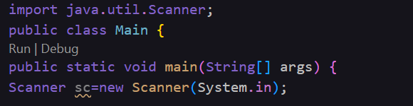

Acció 3.1: Iniciar el repositori
```bash
git init
```
Captura 1:

Acció 3.2: Configurar el control de versions perque identifiqui el nostre nom i el nostre correu
```bash
git config --global user.name
git config --global user.email
```
Captura 2:

Acció 3.3: Creem el primer fitxer (Main.java), i emmagatzemem la informació
```bash
git init
git add .
git commit -m
```
Captura 3:

Acció 3.4: Apliquem dues modificacions
```bash
git add .
git commit -m
```
Modificació 1: Possem el "public static void main" al fitxer de java
Captura 4:

Modificació 2: Importem el Scanner

Acció 3.5: Mostre per pantalla tot l'historial en una linea amb un sol commit
```bash
git log --online
```
Captura 5: git log --oneline

