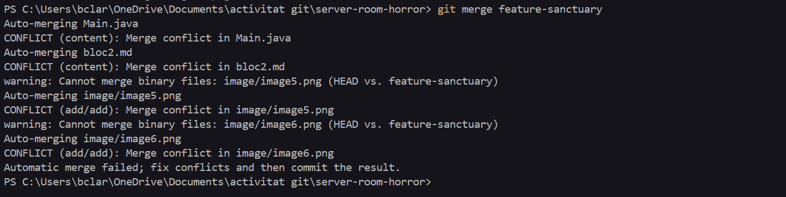
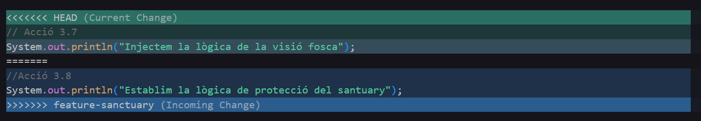
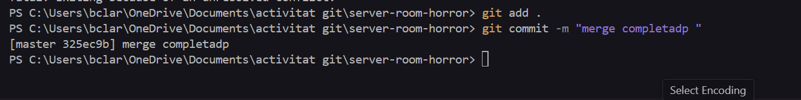

Acció 3.6: Creem dues branques, branca 1 (feature-nightmare) i branca 2 (feature-sanctuary)
```bash
git branch feature-nightmare
git branch feature-sanctuary
```
Captura 7: (branca 1)

Captura 8: (branca 2)

Acció 3.7: Ens desplaçem a la branca feature-nightmare
```bash
git checkout feature-nightmare
```
Captura 9:

Acció 3.8: Ens desplaçem a la branca feature-sanctuary
```bash
git checkout feature-sanctuary
git add .
git commit -m
```
Captura 10:

Captura ?: fem un commit

Acció 3.9: Tornem a la branca principal (master) i fem un merge amb les dues altres branques
```bash
git checkout master
git merge feature-nightmare
```
Captura 11:

Captura 12: fem git merge des de main amb la branca "feature-nightmare"

Captura 13: intentem fer merge amb l'altre branca "feature-sanctuary"

Acció 3.10: Contemplem el conflicte que ha sorgit de fer merge amb la segon branca
```bash
git git merge featutre-sanctuary
```
Captura 14;


Captura 15: Commit de fusió
