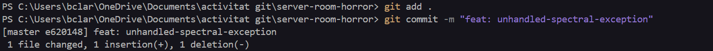
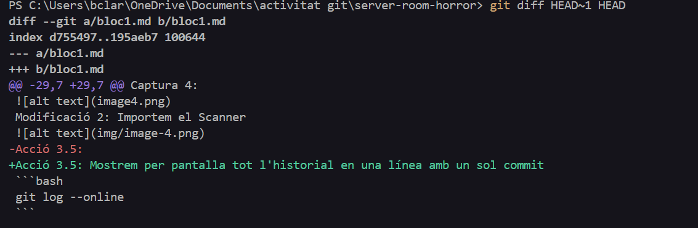

Acció 3.11: Enregistrem l'estat defectuós a l'historial
```bash
git commit -m "feat: unhandled-spectral-exception"
```
Captura 18:

Acció 3.12:Executem aquesta comanda per veure la diferencia entre l'estat anterior infectat i l'actual estat segur
```bash
git diff HEAD~1 HEAD
```
Captura 19:

Acció 3.13:
