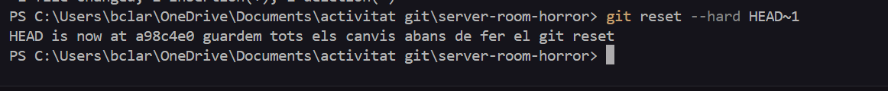
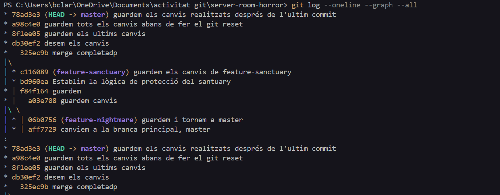
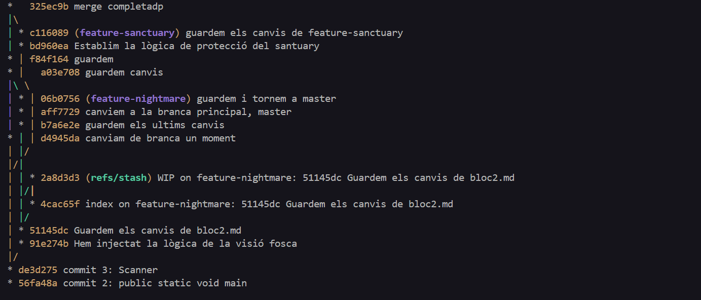
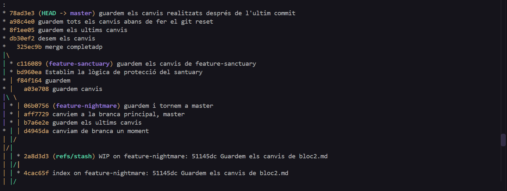
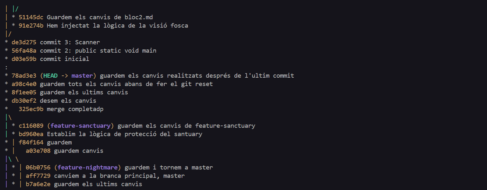
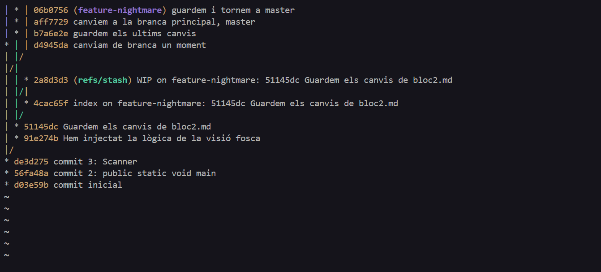
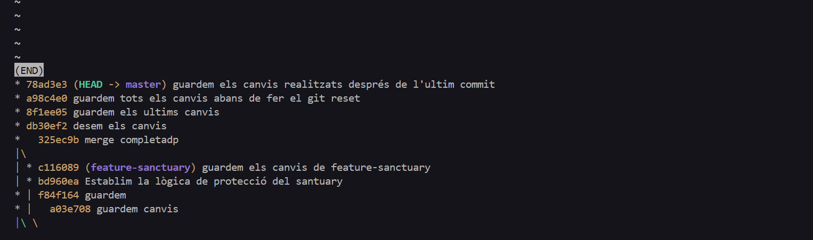
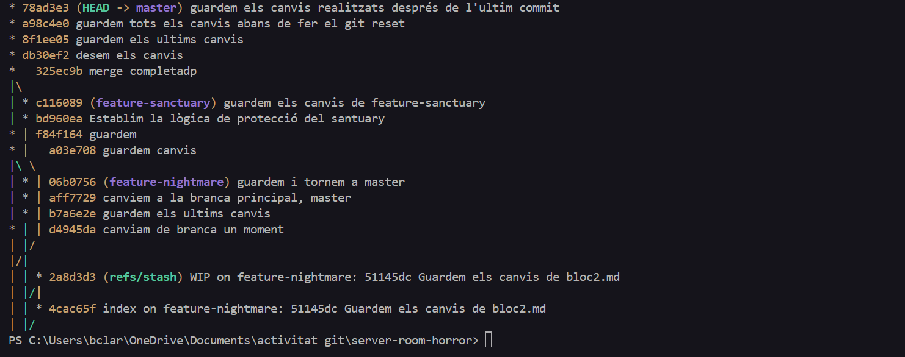

Acció 3.11: Enregistrem l'estat defectuós a l'historial
```bash
git commit -m "feat: unhandled-spectral-exception"
```
Captura 18:

Acció 3.12:Executem aquesta comanda per veure la diferencia entre l'estat anterior infectat i l'actual estat segur
```bash
git diff HEAD~1 HEAD
```
Captura 19:

Acció 3.13:fem un git reset per purificar l'historial (primer hem de guardat tots els canvis anteriors per no perdre'ls)
```bash
git reset --hard HEAD~1
```
Captura 20:

Acció 3.14: Realitzem aquesta comanda: "git log --oneline --graph --all", per poder veure de manera gràfica la topologia del repositori
```bash
git log --oneline --graph --all
```
Totes les captures que hi han a continuació són de com es veu de manera hgràfica tota la topologia del repositori:
Captura 21:

Captura 22:

Captura 23:

Captura 24:

Captura 25:

Captura 26:

Captura 27:

Captura 28:
